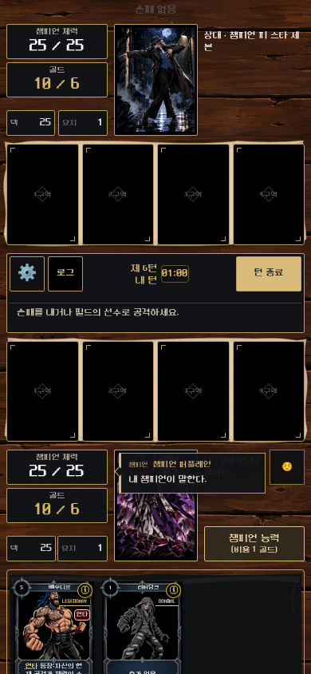
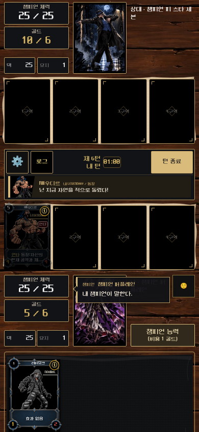

# Distinct champion and wrestler dialogue

Base `ec1801d` (PR #95), branch `feat/distinct-battle-dialogue`.

## Result

Champion emotes/start abilities/quest completion now use a named speech bubble tethered to the actual champion HUD, with a short border emphasis. KO victory/defeat uses the same vocabulary for both actors at the existing portrait-burst callback. No dialogue text, card/champion data, combat rules, audio assets or KO reading duration was changed.

Wrestler dialogue is a separate illustrated ribbon: actual card/skin art, card name, owner side and enter/retire/destroy label. Legendary entrances receive the stronger matte-gold accent. Other existing wrestler/token lines retain their actual identity and wording rather than impersonating a champion.

The summon ribbon starts from the existing `CardPlayAnimation` landing callback, alongside the existing landing feedback, without changing motion/audio timing. When no play animation exists it falls back to the already-applied public event. A bounded eight-entry FIFO prevents one state update's simultaneous speakers from overwriting each other. Dialogue adds no presentation-busy lock and does not pause the turn clock.

The narrow-screen ribbon fits in the existing central instruction row; no new board rows, card scaling or hand repositioning. Errors, targeting/cancel instructions, selected cards/attackers, turn confirmation and intro take priority. Champion bubbles keep health/gold, field/hand cards, ability and image-emote buttons clear, and hide during targeting or open menus. They temporarily use the portrait/name/quest-information side of the HUD; no quest state or controls are removed. Longer custom text can scroll inside the bounded bubble. The current longer lines use compact text when needed.

Bubbles follow camera/scroll movement via a short-lived animation-frame follower, skip unchanged geometry, and release observers/listeners/frames on unmount. Reduced motion disables the slide and portrait emphasis. Text appears as a complete sentence, without a typewriter delay. Game-ID changes, event-log reset, reconnect history and terminal state clear/suppress stale speech.

## Mobile previews

These are local shared-UI captures with existing public artwork and actual engine play/emote events; fixture balance values are not assertions about the live catalog.

| Champion HUD bubble | Legendary entrance ribbon |
|---|---|
|  |  |

## Files

- `champion-speech-bubble.tsx`, `battle-dialogue.css`: shared HUD anchoring, actor label, short motion, collision/viewport constraints and reduced motion.
- `wrestler-dialogue.tsx`: independent typed, illustrated wrestler speech with existing skin framing and a cleaned-up reading timer.
- `game-state-preview.tsx`: separate champion/wrestler state, bounded queue, landing readiness, instruction priority and lifecycle resets.
- `card-play-animation.tsx`: optional landing notification/ref and observable landed state; existing effect timing, motion and audio retained.
- `champion-ko-dialogue.tsx` / `.css`: reuse the shared bubble while retaining two-actor KO timing, IDs, outcomes and result gating.
- `index.css`: remove the obsolete common toast rules; unrelated battle VFX retained.
- Updated quest/champion/KO browser selectors and added `docs/qa/distinct-dialogue-browser.mjs`; no production API or database changes.

Component paths above are under `artifacts/ko-game/src/components/`.

## Executed verification

- Full production build/typecheck: PASS.
- Existing wrestler-event-line, KO-line, presentation-policy, quest-presentation-policy and screen-impact-policy tests: **30 PASS**.
- Real shared battle UI: 360×740, 375×812, 390×844, 412×915, 1440×900, plus reduced-motion 390×844: PASS. Champion/legendary identities, actual landing before speech, command-row bounds, no critical control/card/resource overlap, no repeated consumed speech.
- Two actual opponent plays combined into one state update: both named speakers appear in order, PASS.
- Card selection/cancel takes priority over the ribbon; the authoritative game-state snapshot remains identical through the UI-only selection/cancel flow, PASS.
- Existing quest-completion browser at 360/390/1440 and motion/reduced-motion: PASS, including opponent completion, empty optional lines, same-action/later defeat suppression and reconnect deduplication.
- Existing champion-features browser at desktop/mobile/small: PASS, including retirement/destruction lines and existing administrative configuration flows.
- Existing KO/intro browser at 390/360: PASS, including own defeat, both lines at the actual HUD burst, viewport bounds, no duplicate result quotes, busy release and finished reconnect without replay.
- Existing isolated cosmetics browser: all **8 groups PASS**, including two authenticated PvP clients, reload, image emotes, original-art fallback and real AI setup/start.

Reproduction uses the existing dev server on port 5186 and local fixture tools:

```sh
pnpm run build
node docs/qa/distinct-dialogue-browser.mjs
node docs/qa/champion-quest-dialogue-browser.mjs
KO_QA_PLAYWRIGHT=$PWD/docs/qa/black-gold-playwright.mjs KO_QA_ORIGIN=http://127.0.0.1:5186 node docs/qa/champion-features-browser.mjs
KO_INTRO_KO_SIZES='[[390,844],[360,740]]' node docs/qa/ko-champion-dialogue-browser.mjs
KO_QA_PLAYWRIGHT=$PWD/docs/qa/black-gold-playwright.mjs node docs/qa/cosmetics-browser-runner.mjs
```

Local results: `qa-results/distinct-dialogue/`, `qa-results/quest-dialogue/`, `qa-results/distinct-dialogue-ko-final/`. Fixture credentials stay untracked. There was no real-user study or physical-phone/audio validation. Complete live draft/tower battles were not rerun for this presentation-only change; shared rendering and the specific real PvP/AI flows above are not represented as every-mode proof. Hosted CI status is separate from local checks; previously known broad impact/audio expectation and browser-install failures were not hidden or addressed by weakening approved effects.
