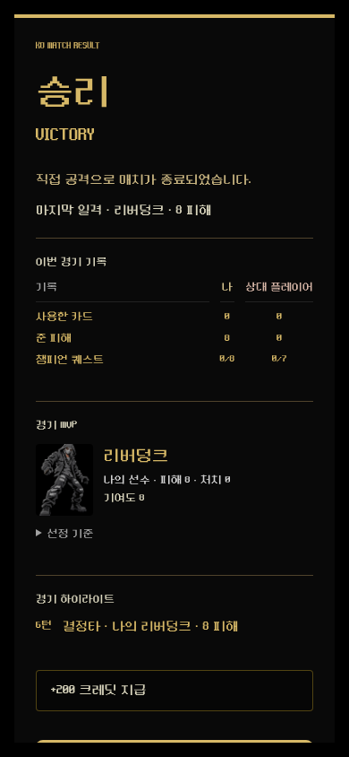
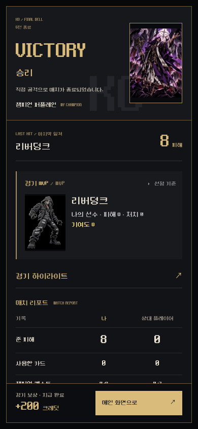

# Match result fight poster and adjustable skin artwork

Base: `0530a81` (PR #94). Branch: `feat/match-result-fight-poster`.

## Result presentation

The previous result was a narrow generic sheet with repeated panels. The new result uses an angular black/gold fight poster: large victory/defeat verdict, the viewer's actual champion artwork, real final hit, MVP spotlight, compared match statistics, expandable highlights and a persistent reward/continue footer. Defeat uses muted rust; an unresolved result remains neutral. No invented rating, fabricated rewards or new statistics were introduced.

The existing `matchSummary`, `buildMatchRecap`, result BGM, authoritative reward state, quest/reward retry callbacks and tower continue action remain in use. Pending rewards do not appear as paid. Champion victory/defeat dialogue still occurs only at the in-HUD KO burst. The normal administrator recap retains its original expanded section.

Keyboard focus is contained while the dialog is open and restored on unmount. Important actions remain visible during internal scrolling. Motion reduction disables the short poster entrance. The design rationale is stronger hierarchy, grouped information and progressive disclosure; no real-user study was performed.

Before and after use the same local real-engine lethal action and public artwork (fixture reward display, not a production credit grant):

| Before, 390×844 | After, 390×844 |
|---|---|
|  |  |

## Skin framing

Administrator cosmetics now reuse the original card artwork component and slider controls: contain/cover/custom, zoom 50–200%, X/Y 0–100%, direct drag and reset. The frame/interaction rectangle stays fixed; only the artwork changes.

- Existing pack-card skins persist through their existing display-mode/scale/position columns and the unified catalog bridge.
- Champion common artwork, awakening artwork and bundled token artwork have separate settings. Common art settings apply consistently to collection, battle HUD and VS intro.
- Modern skins keep validated per-slot settings in the existing JSON asset map's reserved `__display` string. Image URLs remain unchanged and cacheable. No schema migration or original card/champion data edit is needed.
- Server validation rejects malformed/oversized metadata, unsupported slots, nonnumeric values and out-of-range settings. Empty metadata cannot substitute for a required image. Ownership/equipment checks are unchanged.
- Existing match snapshots carry the same settings. Editing a skin does not change a match already in progress; new matches read the new composition.
- The shared card renderer, champion HUD, VS intro, skin previews, pack rewards and result artwork consume the settings. Skin image failure restores the original image's framing. In-HUD KO fragments use the actual displayed fit/scale/position.
- Card backs and emotes retain their previous editor and behavior.

## Changed files

- `lib/cosmetics/src/index.ts`: bounded display metadata parser and common/token display resolution.
- `artifacts/api-server/src/lib/cosmetics.ts`, `legacy-skin-cosmetics.ts`, `routes/cosmetics.ts`: validated persistence, legacy field bridge and loadout serialization.
- `artifacts/ko-game/src/components/image-display-slider.tsx`, `admin-card-manager.tsx`, `admin-cosmetics.tsx`: shared sliders and direct skin artwork editing.
- `card-artwork.tsx`, `card-renderer.tsx`, `cosmetic-battle.tsx`, `cosmetic-preview.tsx`, `game-state-preview.tsx`, `online-match-intro.tsx`, `champion-defeat-burst.tsx`: framing at actual render sites and correct original-image fallback.
- `match-result-overlay.tsx`, `match-result.css`, `match-recap-panel.tsx`: responsive fight poster and result-only recap presentation.
- `pack-opening.tsx`, `src/lib/collection-client.ts`, `pages/home.tsx`, `pages/online-match.tsx`: pack/AI/PvP presentation bindings.
- Development-only `qa/match-result.html`, `qa/match-result.tsx`; pure/HTTP/browser tests and screenshots listed below. QA routes are not production build entry points.

## Executed checks

| Check | Result |
|---|---|
| Full production build and typecheck | PASS |
| Isolated cosmetics HTTP/transaction suite | 23 PASS |
| Display metadata, existing skin-art mapping, recap and KO line pure tests | 18 PASS |
| Result browser: 360×740, 375×812, 390×844, 412×915, 768×1024, 1440×900, 844×390 | Victory and defeat PASS, no horizontal overflow, persistent 44px+ continue action, actual MVP/highlights, no duplicate dialogue |
| Result states | Pending does not invent reward; error retry callbacks, empty result, tower continue label and keyboard containment PASS |
| Existing cosmetics browser | All 8 groups PASS in development and compiled production build, including authenticated PvP, AI start, reload, image emotes and original-art fallback |
| Actual skin editing browser | Drag, sliders, save/reload, reset, legacy pack columns, user preview, frozen PvP HUD/card/token and new AI intro PASS; editor fits 360/390/1440 |
| Draft cosmetics browser | All 4 groups PASS: frozen seat-specific skins, backs, emotes and reload |
| Actual Home AI transcript → server replay | Emote, timeout and surrender cases PASS |
| KO/intro regression | Real lethal engine actions at 390/360, own defeat, original HUD shatter and both dialogue bubbles, result quote absence, reconnect and input release PASS |

Local artifacts: `qa-results/result-poster/`, `qa-results/skin-display/`, `qa-results/result-skin-ko-regression/`. Fixture credentials remain untracked and are not published.

Reproduce with the existing QA loader and loopback-only fixture runners:

```sh
pnpm run build
node --import ./docs/qa/checkpoints/20261006/qa-loader.mjs --test --test-isolation=none lib/db/qa/cosmetics.test.ts artifacts/ko-game/src/lib/cosmetic-image-display.test.ts artifacts/ko-game/src/lib/champion-skin-art.test.ts artifacts/ko-game/src/components/champion-ko-lines.test.ts lib/game-engine/src/match-recap.test.ts
node docs/qa/result-poster-browser.mjs
KO_QA_PLAYWRIGHT=$PWD/docs/qa/black-gold-playwright.mjs KO_COSMETICS_BROWSER_SCRIPT=docs/qa/skin-display-browser.mjs node docs/qa/cosmetics-browser-runner.mjs
KO_COSMETICS_PRODUCTION_BUILD=1 KO_QA_PLAYWRIGHT=$PWD/docs/qa/black-gold-playwright.mjs node docs/qa/cosmetics-browser-runner.mjs
KO_COSMETICS_DRAFT=1 node docs/qa/cosmetics-browser-runner.mjs
```

The result/KO browser scripts require the existing development server on port 5186. Real phones, subjective satisfaction and complete live tower/PvP lethal-result flows were not tested. Shared result actions/KO rendering and real PvP/AI/draft integration are reported separately, not as proof of every game mode. Existing hosted CI heavy-impact legacy audio/shake expectations and browser-install timeouts are separate from the local checks above; hosted status must not be reported as green unless it actually completes successfully.
