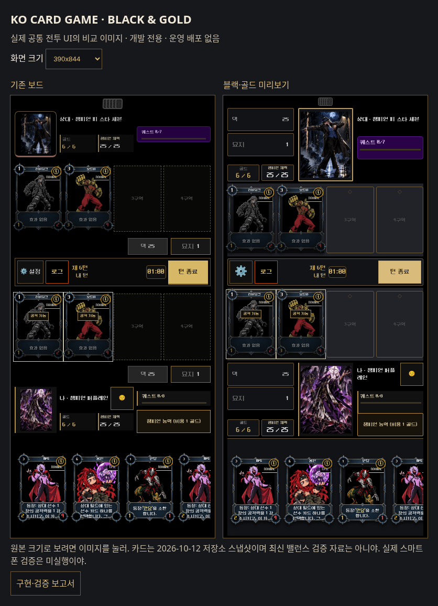

# BLACK & GOLD — 첫 번째 플레이 가능한 개발 프로토타입

기준: 최신 main `ac30343bab4758da185160df8dd6834008965e95`. 작업 시작 시 그 이후 main 변경 없음. 별도 브랜치 `feat/black-gold-battle-board-preview`. 운영 배포·main push/merge·Production DB 변경 없음. 엔진·AI·서버 판정·타워 저장/보상·원본 카드/챔피언/프레임/폰트 리소스 수정 없음.

## 비교 자료

[휴대폰용 비교 페이지](index.html)에서 같은 카드·챔피언·상태·해상도의 원본/미리보기를 비교할 수 있다. PNG는 실제 공유 컴포넌트의 Chromium 렌더링이며 생성형 이미지가 아니다.

| 크기 | 기존 | 블랙·골드 |
|---|---|---|
| 360×740 | [기존](before-360x740.png) | [미리보기](after-360x740.png) |
| 375×812 | [기존](before-375x812.png) | [미리보기](after-375x812.png) |
| 390×844 | [기존](before-390x844.png) | [미리보기](after-390x844.png) |
| 412×915 | [기존](before-412x915.png) | [미리보기](after-412x915.png) |
| 1440×1000 | [기존](before-1440x1000.png) | [미리보기](after-1440x1000.png) |



## 구현과 보호 경계

- `game-state-preview.tsx`: DEV 전용 `boardTheme` 및 안전한 개발 세션 스위치. 기존 `ZoneStack` 요소와 덱 참조·묘지 콜백을 재사용하여 HUD로 이동한다. 다른 게임 이벤트 핸들러와 슬롯·카드 ID는 그대로다. `CLASSIC` 선택은 현재 전투 상태를 유지하면서 이전 배치로 돌아간다.
- `battle-board.css`: 요청한 단색 팔레트, 얇은 테두리, 중앙의 세로 직사각형 초상화, 좌측 덱/묘지, 우측 이름/퀘스트/능력, 중앙 턴 관리, 손패를 구성한다. `CardRenderer`와 카드 프레임은 수정하지 않았다. ⓘ는 기존 19px 시각 크기를 유지하면서 히트 영역만 44px로 확장했다.
- `qa/black-gold-board.html`, `black-gold-board.tsx`, `black-gold-fixture.ts`: 실제 공유 UI와 `executeAction`을 사용하는 개발 전용 수동 전투 샌드박스. 실제 소환/공격 연출과 완료 콜백, 능력·퀘스트·주문·감정표현을 연결했다. 테마 전환·초기화·상대 턴 종료 도구를 제공한다. 별도 QA 타입 검사 설정도 포함한다.
- `docs/qa/black-gold-*.mjs`, `black-gold-artwork-cache.py`: 회귀·프로토콜·빌드 제외 검사. 기존 서버 테스트 소스는 별도의 임시 사본/PGlite로 실행하고 결과 폴더를 분리한다. 원본 테스트와 기존 `qa-results` 파일을 덮어쓰지 않는다. 임시 테스트 코드는 finally에서 정리한다.
- 배포용 빌드에서는 DEV 분기와 CSS import가 제거된다. QA HTML은 빌드 입력에 포함하지 않는다. 140개 빌드 파일에서 개발 스위치·새 CSS 변수·미리보기 경로가 없음을 확인했다. 실제 운영 사이트의 기본 UI는 바뀌지 않는다.

## 실측

| 화면 | 새 초상화 | 필드 카드 너비 기존→신규 | 손패 카드 너비 기존→신규 | 가로 넘침/줌 |
|---|---:|---:|---:|---|
| 360×740 | 93×124 | 69.6→83 | 84.8→84.8 | 없음 / 1 |
| 375×812 | 105×140 | 86.8→86.8 | 92→92 | 없음 / 1 |
| 390×844 | 105×140 | 90.5→90.5 | 92→92 | 없음 / 1 |
| 412×915 | 114×152 | 96→96 | 92→92 | 없음 / 1 |
| 1440×1000 | 120×160 | 181.5→181.5 | 132→132 | 가로 넘침 없음 |

모바일 네 크기의 문서 높이는 각각 뷰포트 높이와 같다. 360px에서는 내 HUD의 실제 조작 버튼 공간을 더 확보하고 손패의 바깥 여백만 조절했으며 카드 크기는 유지했다. 데스크톱은 카드 크기 보존 때문에 기존과 유사한 세로 스크롤(기존 1147px, 신규 1148px 문서 높이)이 있다. 대상 선택 전후 필드 크기는 유지된다. 초상화 `CONTAIN` 및 원본/스킨/각성 fallback 경로를 유지한다.

## 검증 결과

- 일반 workspace 타입 검사, API/Vite 전체 빌드: PASS.
- 신규 QA 엔트리까지 포함한 별도 타입 검사: PASS.
- 전투·챔피언·연출·감정표현 회귀 단위 검사: 60 PASS / 0 FAIL.
- 격리된 서버/DB 회귀: PvP 꾸미기 14, 드래프트 18, 타워 11 — 합계 43 PASS / 0 FAIL.
- 새 보드 브라우저 검사: 9종 × 모바일 4크기 = 36 PASS / 0 FAIL. 테마 전환의 상태 보존, 실측, 대상 취소/골드, 실제 능력으로 퀘스트 완료·강화, 터치 드래그 소환, 연출 중 잠금/복구, 필드/챔피언 드래그 공격/취소, 주문 대상 이동, 파괴 후 빈 슬롯, 상세정보→풀일러, 감정표현, 설정/로그/묘지, 10장 손패 스크롤, 턴 종료 및 직렬화 상태 복원을 검사했다.
- 실제 HTTP/WebSocket PvP/AI 화면 8개, 드래프트 화면 4개, 타워 전투→KO→결과→보상→25장 교체 1개: PASS. 실제 매치 화면에서 새 테마가 켜져 있는지도 검사했다. 타워의 타이머 숨김 정책을 확인했다.
- 기존 공격 드래그 브라우저 4개 화면, 기존 모바일 대상 지정 레이아웃 4개 화면: PASS. 유효 대상/보호/취소 및 대상 선택 전후 크기를 확인했다.
- 위 브라우저 검사 그룹 합계 57 PASS. 실제 스마트폰은 미실행이며 모두 Chromium 모바일 에뮬레이션이다.
- 운영용 빌드의 미리보기 제외 검사: PASS. 운영 테스트 계정·보상·꾸미기 아이템·덱을 생성하지 않았다. 공개 일러스트 파일만 TLS 검증을 유지한 GET으로 캐시하여 사용했다.

실행 중 발견한 새 보드 오류: 대상 안내가 Grid의 암시적 두 번째 열을 만들어 필드가 좁아짐. 각 주요 영역의 열을 명시해 수정했고, 기존/신규 대상 선택 회귀가 통과했다. 타워 검증 첫 실패는 기존 서버 테스트의 마지막 단계가 기능을 OFF로 남기기 때문이었다. 임시 복사본의 격리 DB에서만 활성화·새 도전 초기 상태를 마련해 검증했다. 일반 프로젝트 타입 검사에는 QA 폴더가 제외되어 있어 별도 타입 검사도 추가했고 fixture의 4칸 튜플·공격 횟수 필드를 바로잡았다.

## 미검증·제한

- 실제 휴대폰, Safari 및 장기 실전 성능은 미검증.
- 전용 샌드박스의 타이머는 60초 고정 표시다. 실제 PvP 화면의 기존 서버 타이머는 유지했지만 시간 만료까지 기다리는 별도 시나리오는 미실행이다.
- 기존 스킨 및 실시간 이미지 이모티콘/재접속은 실제 로컬 서버로 검사했다. 모든 챔피언의 각성 이미지 변형과 모든 카드 효과를 전수 검증한 작업은 아니다.
- 영구적인 슬롯 파괴/잠금 상태는 현재 공통 UI·상태 모델에서 확인하지 못했다. 카드 파괴 후 슬롯이 비고 인덱스 0~3을 유지하는 동작은 실제 주문으로 검증했다. 영구 슬롯 파괴를 새 규칙으로 구현하지 않았다.
- 미리보기의 카드/챔피언 콘텐츠는 저장소의 2026-10-12 스냅샷(129 카드/11 챔피언)이다. 이 날짜 이후 운영 효과와 일치한다고 주장하지 않는다. 이번 작업은 시각·조작 검증이다.
- 디자인은 승인 대기 상태다. 데스크톱 높이와 긴 이름의 시각적 다듬기는 후속 디자인 검토 대상으로 남긴다.

## 개발 환경 재현

기존 Node/pnpm 환경을 활성화하고 저장소 루트에서 실행한다.

```sh
PORT=5186 BASE_PATH=/ pnpm --filter @workspace/ko-game dev --host 127.0.0.1
```

개발 경로: `/qa/black-gold-board.html` (기존 UI 비교: `?theme=classic`). 실제 개발용 모드 화면에도 적용하려면 해당 개발 사이트의 세션 스토리지 `ko-dev-black-gold-board=1`을 사용한다. 이 스위치는 production 빌드에서 제거된다. 외부 Production 서버에는 테스트를 보내지 않는다.

```sh
pnpm exec tsc -p artifacts/ko-game/qa/tsconfig.black-gold.json --noEmit
node docs/qa/black-gold-board-browser.mjs
node docs/qa/black-gold-modes-runner.mjs pvp
node docs/qa/black-gold-modes-runner.mjs draft
node docs/qa/black-gold-modes-runner.mjs tower
pnpm run build
node docs/qa/black-gold-production-gate.mjs
```

`KO_QA_PLAYWRIGHT`로 설치된 Playwright 모듈의 절대 경로, `KO_QA_CHROMIUM_EXECUTABLE`로 Chromium 실행 파일을 지정할 수 있다. 서버 검사는 각각 분리된 PGlite를 사용한다. Production DB 마이그레이션은 필요 없다. 이전 UI는 테마 스위치 및 기준 main으로 복구할 수 있다. 운영 배포·병합은 디자인 승인 전 진행하지 않는다.
